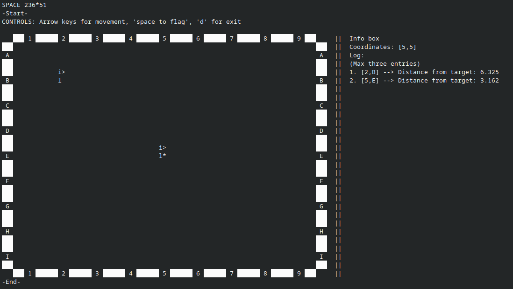
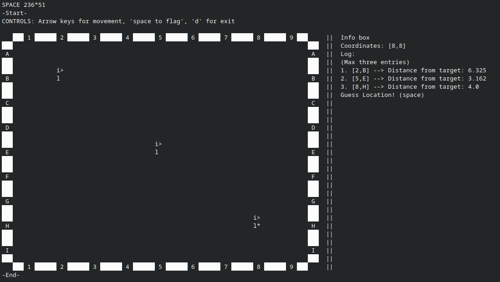
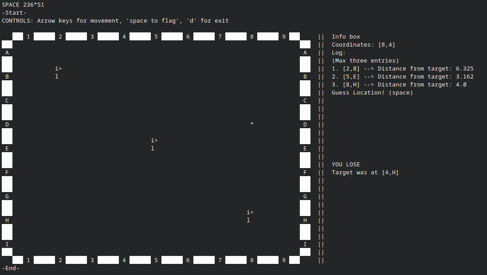

# Target-game-by-typ

Project for Hack Club Terra

Game inspired by Metal-Detectors, Satellite GPS Systems, and maybe a little of the battleship board game

No future updates will be expected for this project

How to install:

* Linux:
    * 1 - Go to releases and download the executable file'main' into your folder of choice
    * 2 - cd into the folder containing 'main' and do 'chmod +x main' (It is reccomended to rename this file as 'main' may be used for other files)
* Windows/Mac: 
    * 1 - Download the file and folder 'pyproject.toml' and 'main' into your folder of choice
    * 2 - cd into the folder containing both and run 'pyinstaller --onefile main/main.py'
    * 3 - Now there should be a folder named dist with the script named 'main'

How to play:
* Controls
    * Arrow Keys
        * Left Arrow: Move left
        * RIght Arrow: Move right
        * Up Arrow: Move up
        * Down Arrow: Move down
    * Spacebar: Plant flag/comfirm guess
    * D key: Exit script

* Gameplay
    * Fullscreen your terminal window (else it will clip over itself)
    * Start the game by running it in terminal (Linux do ./main)
    * Using arrow keys to move around, find a place to plant first flag

    

    * On the right you will see your coordinates and information about where the target can be
    * Based off your information, plant your second flag elsewhere

    

    * Now you have two flags, now make a wise choice based off of your previous guesses to plant your thrid flag so that it will yeild best result as it is your last

    

    * You have used up all your flags, now, using the log on the right, determine where the flag may be

    

    * Oop, seems like I lost, on the right it says so. It seems like the target was in the other direction!
    * Now use the 'D' key to exit the game to run the script again and try again
